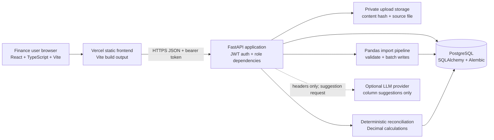

# ReconFlow System Architecture

The frontend is a single-page React application. It calls the `/api` FastAPI routes with a JWT bearer token. The API applies authentication and finance-role checks before reading or changing finance data. PostgreSQL is the system of record; Alembic owns schema changes. Upload bytes are stored under a private upload directory, and their content hash and import metadata are stored in PostgreSQL.

CSV/XLSX inputs pass extension/signature, size, duplicate-hash, header, mapping, and value validation. Pandas import processing uses chunked CSV processing and bulk persistence. Reconciliation is deterministic application code using Decimal and source records. An optional LLM sees column headers for mapping suggestions only; the finance user approves mappings explicitly.

The Render blueprint defines the API, managed PostgreSQL, migrations before startup, and a persistent upload disk. Vercel serves the Vite output with SPA route fallback. The hosted systems are not provisioned yet; URLs are intentionally omitted until verified.
